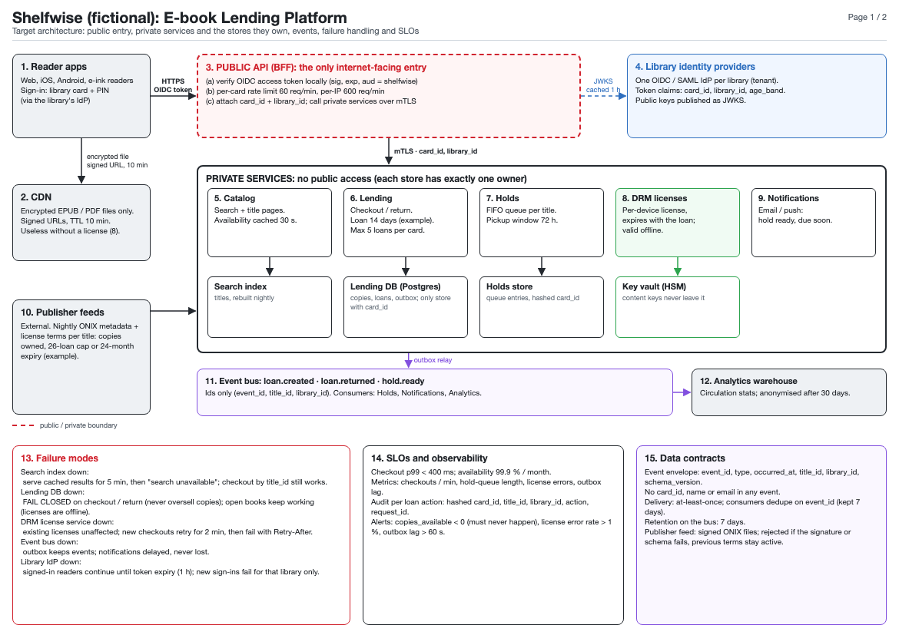
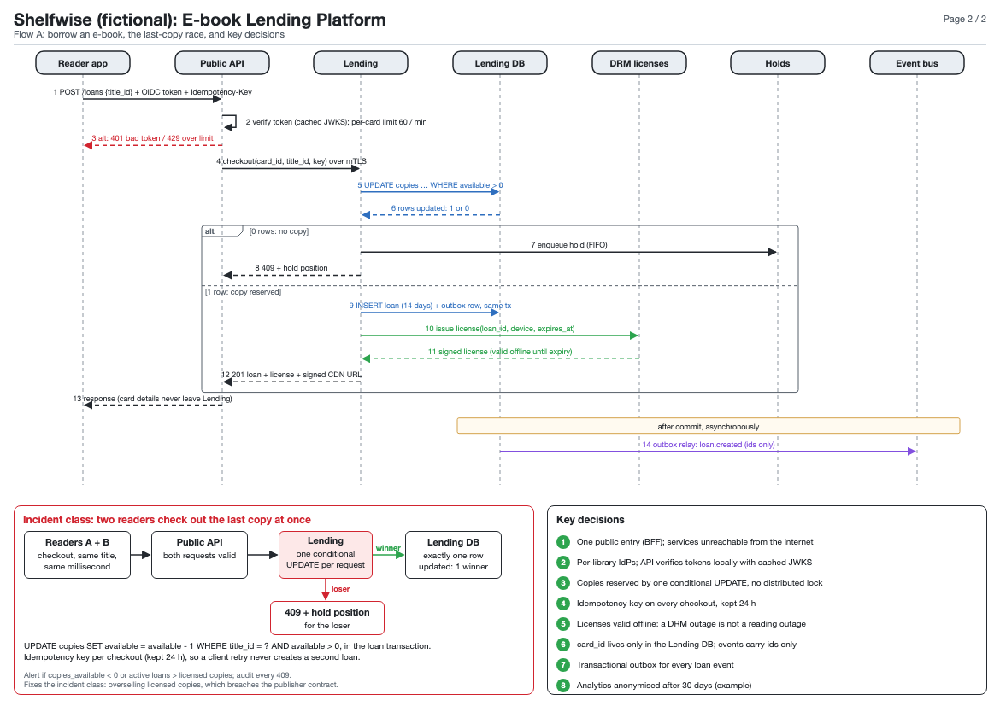

# Architecture Board: a Claude Code plugin

Turns a system description, a whiteboard photo, a codebase or infra config into
a **review-ready architecture board**. A board is a dense, precise document a
staff engineer or security reviewer can approve or reject in one sitting.



<details><summary>Page 2: sequence, incident flow, key decisions</summary>


</details>

[Example PDF](docs/example.pdf): "Shelfwise", a fictional e-book lending platform generated by the skill.

## What it produces
- **Pages:** an overview / trust-boundary map, sequence diagrams (with `alt`,
  `loop`, `opt` and `par` frames and notes), threat or incident flows, data &
  async, deployment, failure & operations, and a changes or key-decisions
  list. Use as many pages as the design needs.
- **Outputs:** PDF, editable HTML, a PNG per page, and Mermaid source for
  every sequence diagram.
- **Formats:** A4, A3 or Letter, landscape or portrait, mixable in one PDF.
- **Themes:** light, dark, or your brand colours (CSS variables).
- **Languages:** any, including Arabic and other right-to-left scripts.
- **Board kinds:** security/auth, backend services, data pipelines,
  migrations, frontend/mobile, infrastructure. The rules switch on by kind.

Every box says what a component does, and every arrow carries its contract,
for example `validate credential (mTLS + service identity)`. Numbers are
concrete (`TTL 5 min`, not "short-lived"). Each dependency has a failure
mode, and everything is numbered so reviewers can point at "step B-7".

## Install
In Claude Code:
```
/plugin marketplace add youssefnabill/claude-architecture-board
/plugin install architecture-board@architecture-board
```

Then ask for a board, for example:
> Draw an architecture board for our checkout service: API gateway, payments, inventory, Kafka events. Include the card-testing incident from last month.

## Requirements
- **Node.js 18+** for rendering.
- **Chrome, Chromium or Edge.** If none is installed, the renderer downloads
  Playwright's Chromium once.
- On first render, `playwright-core` is installed from npm into
  `~/.cache/architecture-board` (override this with `XDG_CACHE_HOME`).
- Optional: `pdftoppm` (poppler) for previews when Node.js isn't available.

## Layout
```
.claude-plugin/marketplace.json
plugins/architecture-board/
  .claude-plugin/plugin.json
  skills/architecture-board/
    SKILL.md                         workflow, board kinds, rule modules
    references/content-checklist.md  what each page type must contain
    references/visual-spec.md        theme, formats, RTL, arrow() and drawSequence() APIs
    assets/template.html             rendering engine + fictional example board (Shelfwise)
    scripts/render.sh, render.mjs    HTML → PDF + PNG + Mermaid + layout checks
```

## Limitations
- Arrows are routed orthogonally but don't avoid obstacles. Use `via` or
  other sides when an arrow crosses an unrelated box. The skill checks the
  PNGs for this.
- Sequence diagrams have no activation bars.
- There is no direct draw.io or Confluence export. Use the PNG or Mermaid
  outputs.

## License
MIT. See [LICENSE](LICENSE).
